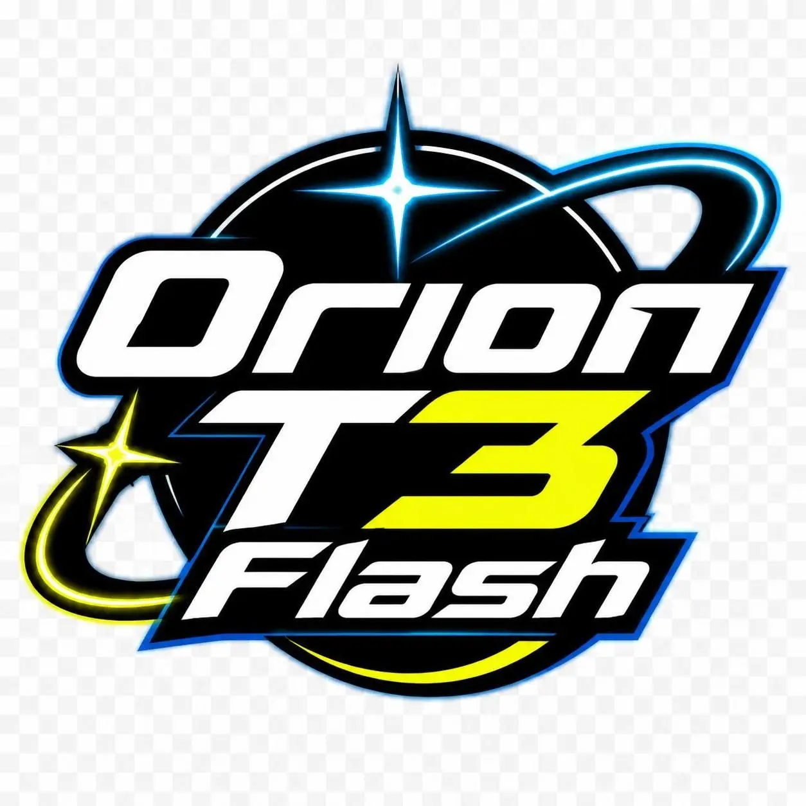

# Orion T3 Flash — Official Launch Film 🚀

## 🎬 Watch the complete launch film

### [▶ Orion T3 Flash — Official Launch Film (Full HD MP4)](Orion_T3_Flash_Official_Launch_1080p.mp4)

**Direct video file:** [Orion_T3_Flash_Official_Launch_1080p.mp4](https://github.com/smilyai-labs-team/hey-gpt-put-your-launch-vid-here/blob/main/Orion_T3_Flash_Official_Launch_1080p.mp4)

The film is **published and verified in this repository**. Its Git blob hash was checked against the rendered source file. The [automated build passed](https://github.com/smilyai-labs-team/hey-gpt-put-your-launch-vid-here/actions/runs/38997959998).

| Specification | Exported film |
|---|---|
| Running time | 5:27.658 (complete original song; no intentional cuts) |
| Resolution | 1920 × 1080 |
| Frame rate | 30 fps |
| Video | H.264 / MP4 |
| Audio | AAC |
| Format | 16:9 landscape |
| File size | 9.9 MB (web-friendly 1080p edition) |

This repository carries the web-friendly encoding; a larger higher-quality master and the editable production ZIP were also delivered in the originating ChatGPT conversation.

### Try Orion

**🌐 https://orion.smilyai.org**

### Confirmed product details

- Built for fast responses; actual speed varies with server load.
- Standard context window: **262K tokens**.
- Optional **1M-token** context window, available on request by emailing the team (using YaRN).
- **Text and image input; text output only.**
- General questions and coding assistance.
- **Instant** (default) and **Low** effort modes.
- **Free to use through January 1, 2027.**
- Orion T3 Flash is proprietary; the production script here does not include model code or weights.

### Production source and integrity

- [Reproducible film renderer](production/render.py)
- [Scene and technical plan](PRODUCTION_PLAN.md)
- [Film reconstruction workflow](.github/workflows/assemble-film.yml)
- [Verified assembly information](PUBLISHING.md)
- [Original logo](assets/orion-logo.webp)

All UI examples in the film are clearly labelled illustrative concepts, not recordings of the live product. The audio was supplied by the project owner; they should confirm distribution rights.

**MP4 SHA-256:** `c9b0f7e1e59da5c3502902547bf3aa727a25e66bb074ae154dd63fce7f3ad459`
